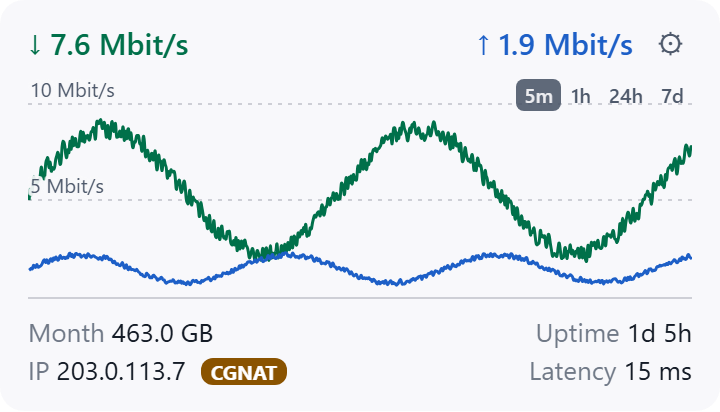
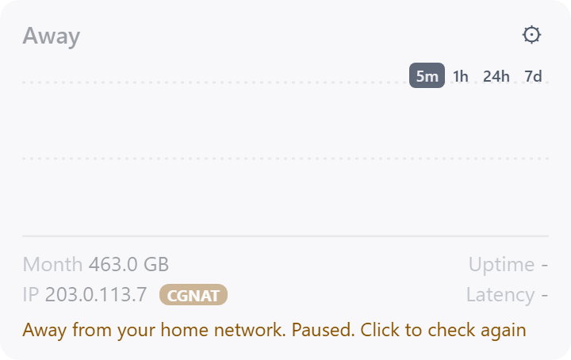

# WAN Widget for UniFi

<picture>
  <source media="(prefers-color-scheme: dark)" srcset="docs/images/widget-dark.png">
  
</picture>

A small Windows 11 desktop widget that shows, from your UniFi gateway's local API:

- a live graph of WAN download and upload throughput
- data used so far in your billing month
- your public IP address, with a CGNAT badge when the gateway's WAN address differs
- uptime: how long the WAN link has been up since its last disconnect
- internet latency, as measured by the gateway
- an "Away" state that pauses everything when you take the PC off your home network

It sits on top of other windows or pins to the desktop, lives in the tray, and can
start with Windows.

> Not affiliated with or endorsed by Ubiquiti Inc. UniFi is a trademark of Ubiquiti Inc.

## Requirements

- Windows 11 (WebView2 is built in)
- A UniFi gateway running UniFi OS with the Network application. Tested on a UCG Ultra
  with Network 10.6. Reports from other consoles and versions are welcome.
- A UniFi API key

## Setup

1. In the UniFi Network app, open **Settings > Control Plane > Integrations** and
   create an API key.
2. Start the widget. On first run it opens Settings: enter the gateway address
   (default `https://192.168.1.1`), paste the API key, and press **Test connection**.
3. Set your billing day so the monthly figure resets when your ISP's month does. The
   month starts at midnight in the gateway's timezone, which the widget reads from the
   gateway. Set a timezone only to override it.
4. Press **Save**. The widget starts showing live numbers within a few seconds. Turn on
   **Start with Windows** if you want it every time you sign in.

The gateway uses a self-signed certificate. The widget trusts the certificate it sees
on the first connection and refuses a different one later, until you press
**Forget pinned certificate** in Settings.

## Using the widget

Hover a figure for detail:

| Field | Tooltip |
|---|---|
| Month | The download and upload split for the billing month |
| Uptime | Your ISP, how long the WAN link has been up and when it came up, and how long the gateway itself has been running and when it booted |
| IP | Your public IP and the gateway's WAN address |
| Latency | Latency to each target the gateway monitors (Microsoft, Google and Cloudflare, as in the UniFi app), the average, lowest and highest over the last few minutes, and WAN availability over the last 24 hours |

Latency and uptime are measured by the gateway, so they describe your internet
connection rather than your Wi-Fi. Per-target latency and availability need a gateway
that reports `uptime_stats`; without it you still get the overall latency.

The tray menu (left-click the icon to show or hide the widget) has Click-through, Pin
to desktop, Check gateway now, Settings, Start with Windows and Check for updates.

### Away from home

<picture>
  
</picture>

The widget talks only to your gateway, so away from home it has nothing to show. After
three polls in a row get no answer and the PC's network address has changed since the
last good reading, it says Away, dims the last values and stops polling. Nothing is
sent to the gateway or the IP lookup until it resumes, which happens when:

- the PC's network address changes (you join another network, or come home),
- you click the banner or choose **Check gateway now** in the tray, or
- you save settings.

If the gateway is down while the PC is still on your home network, the widget does not
go Away. It keeps retrying, backing off to once a minute, and recovers by itself.

### If something looks wrong

| You see | Likely cause |
|---|---|
| "The gateway rejected the API key" | The key is wrong or was deleted. Create a new one and paste it in Settings |
| "The gateway has no site with that name" | The site in Settings is not `default`. Use the site's name as shown in the UniFi Network app |
| "Can't reach the gateway" | Wrong address, or this PC is not on the gateway's network. Away mode takes over after about 30 seconds if you have left it |
| "The gateway's certificate has changed" | The gateway regenerated its certificate. If you expected that, press **Forget pinned certificate** in Settings |
| "No recent data" | The widget has not heard from the gateway for 15 seconds. It dims and recovers on its own |
| Uptime or Latency shows `-` | The gateway did not report it. Older Network versions may not; check for an update |

Settings has **Test connection** and **Open log folder**; attach the log when reporting
a problem.

### Privacy

The widget talks to your gateway and, for the public IP, to `https://api.ipify.org`
every 5 minutes. You can change the lookup address or turn it off in Settings. Nothing
else leaves your network.

## Configuration files

Settings live in `%APPDATA%\io.github.fergus.unifi-widget\settings.json` (see
`crates/widget-core/src/settings.rs` for fields and defaults). The API key is stored
in Windows Credential Manager (service `unifi-widget`), never in that file.

Other files in the same folder, all written by the app:

- `window.json`: window position and the Pin to desktop choice.
- `gateway-pin.json`: SHA-256 of the gateway's certificate, pinned on first connection.

Errors go to a log file in `%LOCALAPPDATA%\io.github.fergus.unifi-widget\logs`
(Settings > Open log folder). Attach it to bug reports; it never contains the API key.

The installer installs per user to `%LOCALAPPDATA%\WAN Widget for UniFi`. Start with
Windows writes an HKCU Run entry that points at the exe it was enabled from, so turn it
off and on again after moving the app.

## Building from source

| Path | What | Builds on |
|---|---|---|
| `crates/widget-core` | Parsing, billing-cycle maths, CGNAT detection, settings validation (no I/O) | Linux and Windows |
| `ui/` | Static HTML/JS front end; opens in a plain browser with synthetic data | Anywhere (Node 22 for tests) |
| `src-tauri/` | Tauri 2 shell: window, poller, tray, settings file, Credential Manager | Windows |

Tests:

```
cargo test            # widget-core
cd ui && npm test     # graph helpers and formatters
```

The Windows app needs Rust, Node, WebView2 and the Visual Studio C++ build tools:

```
cargo install tauri-cli --version "^2"
cd src-tauri
cargo tauri dev                        # run from source
cargo tauri build                      # NSIS installer in target\release\bundle\nsis
```

To release, set `version` in `src-tauri/Cargo.toml` (the only place the app version
lives), add the changes to [CHANGELOG.md](CHANGELOG.md), then push a matching tag (for
example `v0.1.1`). The Release workflow builds the installer and opens a draft
GitHub release with it attached.

Design notes, API findings and open risks are in [docs/DESIGN.md](docs/DESIGN.md).

## License

Licensed under either of [Apache License, Version 2.0](LICENSE-APACHE) or
[MIT license](LICENSE-MIT), at your option.

Unless you explicitly state otherwise, any contribution intentionally submitted for
inclusion in this project by you, as defined in the Apache-2.0 license, shall be dual
licensed as above, without any additional terms or conditions.
